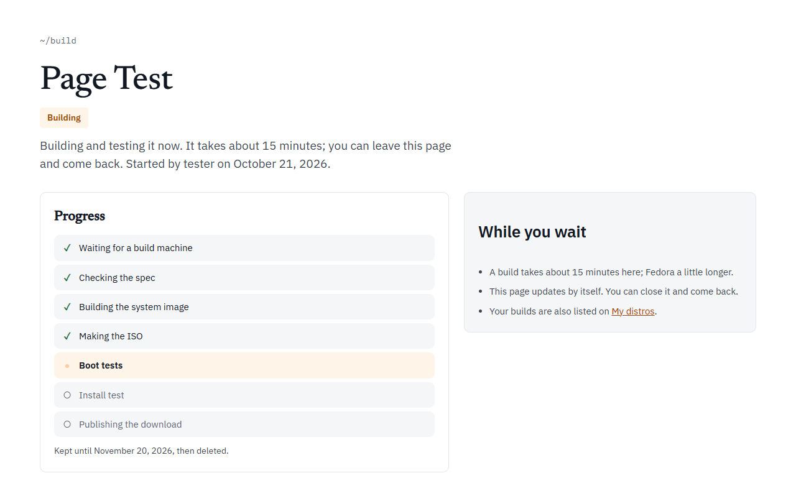

Every **Build it for me** build has its own page at `linuxlive.com/build/?id=<id>`. The Workshop takes you there as soon as the build starts. The id is your GitHub login and six random letters and digits, such as `you-k3x9qa`.

The page is public: anyone with the link can watch the build and download the ISO. It updates itself every 20 seconds, so you can close it and come back. Your builds are also listed on [My distros](/distros/my-distros/), under "Built for you".

Distros built in your own GitHub have no build page. Their progress and ISO are on the run in the repository's **Actions** tab.

## While it builds

At the top are the distro's name, a badge ("Waiting" or "Building") and a line saying who started it and when. Below, **Progress** lists the steps. A tick marks each step that is done, a dot the one running now.

| Step | What happens |
| --- | --- |
| Waiting for a build machine | The build is in the queue. The server builds one distro at a time. |
| Checking the spec | A fresh build machine starts and checks the spec. |
| Building the system image | The spec is compiled and the system is built from Ubuntu's or Fedora's packages. |
| Making the ISO | The system is packed into the ISO, and the ISO is inspected. |
| Boot tests | The ISO is started five ways in a virtual PC. |
| Install test | The ISO installs itself to a disk, and the disk is started. For Fedora-based builds this step is called "Checking the results", since they are live only. |
| Publishing the download | The ISO and its files are uploaded. |

A build on linuxlive.com's server takes about 15 minutes, Fedora a little longer. The box beside the steps says the same, under "While you wait".

## When it is done

The page changes to look like a Library distro's page. The badges say "Ready", the base, "Installable" or "Live only", "Secure Boot" when that boot passed, and how many days are left.

- **The desktop.** A screenshot of the desktop as the boot test saw it, on the first start from USB.
- **At a glance.** The download's size, how many boot tests passed (for example "5 of 5"), the day it was built, and the day it will be deleted.
- **Get it.** **Download ISO**, with its size in GiB. Under it is the ISO's SHA-256 checksum with a **Copy** button. Check your download against it: see [Make your first distro](/start/first-distro/#4-check-the-download).
- **Installable or live only.** An Ubuntu-based build says "Installable: start it, then choose Install on the desktop or in the boot menu. The installer erases one whole disk." A Fedora-based one says "Live only: linuxlive.com cannot make Fedora-based builds installable yet."
- **Every package and its source.** A link to the list of every package in the ISO, its version and the source package it came from.
- **Boot-tested.** Each test with a tick or a cross: the five boots, then for Ubuntu-based builds "Installed to a disk", "Started from that disk, with Secure Boot" and "Started from that disk, under BIOS". A distro with **Save files and settings on the USB stick** also shows "Saved files on the USB stick" and "Found them again after a restart".
- **Read the build log.** The whole log of the build, at the bottom of the page.

If the page says "Built. The download is being published; this page shows it in a moment.", the build has finished and the files are still uploading. Wait; it carries on by itself.

## How long it is kept

30 days from the moment you started the build. The date is on the page ("Kept until ..."). Then the ISO, its files and the page are deleted, and the link answers "No such build. Builds are kept for 30 days."

A Build it for me build is never rebuilt, so it does not get newer packages. The "Keep it for good" box on the page says what to do instead: make the same distro with **Build it in my GitHub**. That keeps it in your own repository, rebuilds it every month, and lets you change it and share it in the Library. See [Ways to build](/start/ways-to-build/).

## When it fails

The badge says "Did not finish" and the line under the name says "This build did not finish. The step that failed is marked below." The step that failed has a red cross, and often a short reason beside it.

Two reasons come from the server rather than your distro:

- "no build machine was free; start it again": nobody picked the build up within 12 hours. Start it again from the Workshop.
- "the build machine stopped answering": the build machine went quiet for 20 minutes in the middle of the build. Start it again.

For anything else, choose **Read the build log**. The "What now" box beside the steps says the same: change the distro in the Workshop and build it again. A distro that keeps failing here can also be built in your own GitHub, where you see every step. [Failed builds](/help/failed-builds/) and [Build checks](/help/build-checks/) explain the common failures.

A build that was stopped says "Stopped" and "This build was stopped before it finished."

## Builds made on GitHub

linuxlive.com can also send **Build it for me** builds to GitHub Actions instead of its own server. Those builds have the same page and the same steps. Instead of the build log, the page links to **Watch every line on GitHub**, and a build takes about 30 minutes for Ubuntu and 40 for Fedora.
