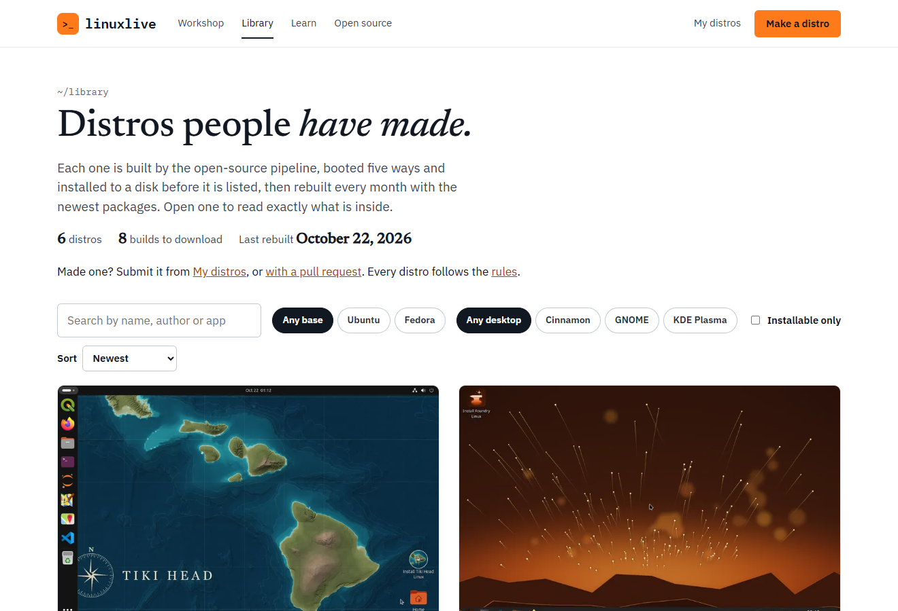

The [Library](https://linuxlive.com/library/) is where people share the distros they made. Anyone can download one, no account needed. Every distro in it was built by linuxlive from a public spec, booted five ways and installed to a disk before it was listed, and is rebuilt every month with the newest packages. Nobody can upload a finished ISO.

Behind it is a public GitHub repository, [Eric-Ness/linuxlive-library](https://github.com/Eric-Ness/linuxlive-library). Each distro is a folder there, added by pull request and reviewed by a maintainer.

## Finding a distro

The Library's front page lists every distro with a screenshot, its base and desktop, its size and how fast it reaches the desktop. Search by name, author or app, filter by base and desktop, or tick **Installable only**. Tags mark distros that are installable and those with **Own scripts**.



Each distro has its own page with:

- the desktop as the boot test saw it, the download size, the time to the desktop, the number of apps and when it was last built
- the apps, the desktop and base, and anything it adds of its own: packages, files, scripts and code from GitHub
- the whole spec, with a **Copy** button
- **Boot-tested**: each of the five boots with its time, and the install, with a link to the test run
- **Version history**: every change to its folder in the Library repository
- its author, with a link to the author's page listing all their Library distros, and the distro's own website if it has one

A distro that runs scripts of its own says so: "Runs its own scripts", and a note that the Library read every line before publishing it.

## Downloading

**Download ISO** gets the ISO from downloads.linuxlive.com. A distro built for ARM too has **Download for PC** and **Download for ARM**; the ARM ISO is for virtual machines on Apple-silicon Macs and does not start on a PC.

Beside the button is the ISO's SHA-256 checksum. Check your download against it before you write it to a stick:

```powershell
Get-FileHash .\my-distro.iso -Algorithm SHA256
```

On Linux, `sha256sum my-distro.iso`; on macOS, `shasum -a 256 my-distro.iso`. The result must match the checksum on the page, character for character. A `.sha256` file also sits beside each ISO on downloads.linuxlive.com.

The page also links to **every package and its source**, a list of each package in the ISO with its version and the source package it came from. [linuxlive.com/source/](https://linuxlive.com/source/) explains how to get that source code from Ubuntu or Fedora, and linuxlive's written offer to supply it.

Then try it: [VirtualBox](/help/virtualbox/), [USB stick](/help/usb-stick/).

## Likes and download counts

A distro's page shows how many times it was downloaded and how many likes it has. To like a distro, choose **Like** and sign in with GitHub; each GitHub account can like a distro once. The Library's **Popular** sort uses these counts.

Downloads are counted without cookies and without storing addresses. Resumed downloads, crawlers and headless browsers are not counted.

## Remixing

**Remix in the Workshop** on a distro's page opens it in the Workshop as a new distro of your own at version 0.1, with "Remix" added to its name. Change anything, then build it. Your spec keeps a line crediting the original and its art's licence. See [Open and remix](/workshop/open-and-remix/).

You can also copy the spec from the page and paste it into your own copy of the [template](https://github.com/Eric-Ness/linuxlive-distro).

## Submitting your distro

First make the distro in your own GitHub, with **Build it in my GitHub** or the template, and get a green build. A **Build it for me** build cannot go into the Library directly.

### From My distros

On [My distros](/distros/my-distros/), a distro whose latest build passed has **Submit to the Library**. It opens a short form:

| Field | Limit | What to write |
| --- | --- | --- |
| One line about it | 100 characters | The tagline under the distro's name |
| A few sentences | 600 characters | What the distro is and who it is for |
| Where the wallpaper and logo come from | 400 characters | "Your own work, or say whose and under which licence." |
| Website (optional) | 200 characters | Your distro's own site, `https://` only |
| Licence for the spec and art | One of five | CC0 1.0, MIT No Attribution, MIT, CC BY 4.0 or CC BY-SA 4.0 |

The name comes from your spec and the author is your GitHub login. Choose **Open the pull request**. linuxlive.com copies your spec, its wallpaper and logo, and your `scripts/` and `files/` folders into a new folder named after your repository, writes the listing from the form, and opens the pull request from a fork of the Library in your account. Forking can take half a minute.

The repository's name becomes the distro's address in the Library, so it must be 3 to 40 lowercase letters, digits and dashes. `lawn-darts-linux`, `testos` and `index` are taken.

Afterwards the card shows **Waiting for review**. When your repository has a newer version than the Library's copy, the button reads **Send 0.3 to the Library**; while a pull request is open it reads **Update pull request #12**, and sending again updates it.

### By pull request

You can also add the folder yourself. Fork the [Library repository](https://github.com/Eric-Ness/linuxlive-library) and add one folder, `distros/<slug>/`:

```text
distros/my-distro/
  linuxlive.yaml   your spec, unchanged
  assets/          the wallpaper and logo it names (PNG or JPEG), and a boot
                   splash's .script and PNG images if it has one
  scripts/         its own scripts, if the spec has any (text files)
  files/           files the spec copies into the system, if any
  listing.yaml     how the Library shows it
```

The listing:

```yaml
name: My Distro              # as shown on the page, up to 60 characters
author: your-github-login    # must be the pull request's author
tagline: One line, up to 100 characters.
about: >-
  A few sentences about it, up to 600 characters.
credits: Where the wallpaper and logo come from, and their licences.
license: MIT-0               # MIT-0, MIT, CC0-1.0, CC-BY-4.0 or CC-BY-SA-4.0
website: https://example.org # optional: https only, up to 200 characters
```

`credits` may be up to 400 characters. Then open a pull request.

To update your distro later, open another pull request changing its folder.

## What is checked

When a pull request opens, the Library's check runs in two parts.

**The folder and listing.** The check refuses a pull request when:

- it changes anything outside one `distros/<slug>/` folder, or more than one distro
- the folder name is not 3 to 40 lowercase letters, digits and dashes, or is taken
- the folder holds anything but `linuxlive.yaml`, `listing.yaml`, PNG or JPEG images and a splash's `.script` in `assets/`, scripts in `scripts/` and files in `files/`
- an image is not really a PNG or JPEG, or a file is a symbolic link
- a script is not a text file of at most 256 KB, or a splash script not one of at most 64 KB
- the folder holds more than 30 MB in all
- the spec names art, a splash, a script or a file that is not in the folder
- a listing field is missing, empty or too long, or the listing has a field it does not know
- the licence is not one of the five above, or the website is not an `https://` address on a domain name
- the listing's `author` is not the GitHub account that opened the pull request

A failure lists each problem, for example "listing.yaml: author is 'someone', but the pull request is by 'you'".

**The build.** The distro is then built and boot-tested with the Library's linuxlive release, exactly as your own build was. Nothing is published from a pull request.

## What reviewers read

A maintainer reviews every pull request before merging. They read the listing and look at the art against the [rules](https://linuxlive.com/policy/): nothing harmful or illegal, only art you may share and have credited, no other project's logos or trademarks, and an honest description.

A distro with code of its own, `scripts` or `repos` in its spec, gets a closer review. The check lists every script and repository in its summary, and the maintainer reads each one before merging, because they run as root in the build and on every computer that installs the distro. GitHub repositories must be public and pinned to an exact commit, and a pull request that moves a commit is reviewed again.

## After the merge

Merging builds the distro again, boot-tests it, and uploads the ISO, its checksum and its package list to downloads.linuxlive.com. Its Library page appears with linuxlive.com's next hourly update. My distros shows the steps in between: "Version 0.2 is in the Library, and its ISO is being built and boot-tested now."

From then on:

- The Library rebuilds every distro once a month, on the 3rd, with the newest packages. When the Library moves to a new linuxlive release, every distro is rebuilt with it.
- A distro is published only if its own build passed. One whose rebuild fails keeps its last good ISO.

## Removing a distro

- **Your own.** Open a pull request deleting its folder, or write to abuse@linuxlive.com. Deleting the repository from [My distros](/distros/my-distros/) opens that pull request for you.
- **Someone else's.** To report a distro that breaks the rules, or art or a trademark that is yours, write to abuse@linuxlive.com with the distro's page address and what is wrong. See [Rules and reporting](https://linuxlive.com/policy/).

A distro that breaks the rules is removed: its folder is deleted from the repository, which deletes its ISOs, and its page goes with the next update of the site.

## Source code

The ISOs hold Ubuntu's or Fedora's packages under their own licences, and linuxlive's own GPL code. [linuxlive.com/source/](https://linuxlive.com/source/) explains how to get the source of everything in an ISO, and carries linuxlive's written offer: write to abuse@linuxlive.com with the subject "Source request", naming the distro's page and the ISO's SHA-256. Each distro's spec and art are public in the Library repository, under the licence its listing names.
