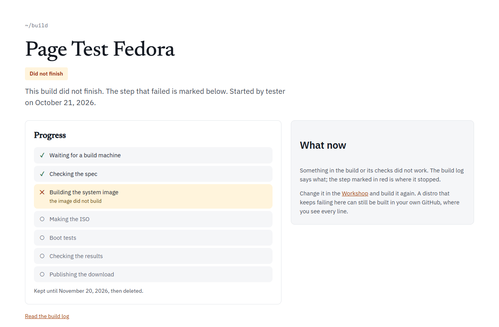

A build stops at the first step that fails. Find that step first:

- **In your GitHub**: open the run on the **Actions** tab. The summary says `The build or a check failed. Open the failed step above for the reason.` Click the step with the red cross and read the last lines.
- **Build it for me**: the build page marks the step where it stopped in red, with a short reason under it. **Read the build log** (or **Watch every line on GitHub**) has the full story.



Most failures fall into one of the causes below. [What a build checks](/help/build-checks/) explains every check by name.

## Before the build: the Workshop's own messages

The Workshop checks your choices with the same rules as the pipeline. While anything is wrong, a message box lists the problems and **Download the kit (.zip)**, **Build it in my GitHub**, **Build it for me** and the Save button stay greyed out. Fix each one and the buttons come back.

| What you see | What to do |
| --- | --- |
| Give your distro a name. | Type a name on the first step. |
| Names use letters, digits, spaces and . _ + -, start with a letter or digit, and stay under 40 characters. | Change the name to fit. |
| That name is too short to make an id from; use at least two letters or digits. | Use a longer name. |
| Versions look like 0.1 or 2026.10. | Change the version. |
| The wallpaper must be a PNG or JPEG file. | Save the picture as PNG and upload it again. |
| The wallpaper is 1024 by 768; it needs to be at least 1280 by 720. | Use a bigger picture. |
| The logo must be a PNG file. | Save the logo as PNG. |
| The logo is 300 by 300; it needs to be square: 128, 256 or 512 pixels. | Resize the logo to exactly one of those sizes. |
| The accent must be a colour like #e0661f. | Pick the colour again. |
| org.example is not a Flathub ID (they look like org.gnome.Chess). | Check the ID on flathub.org. |
| org.mozilla.firefox is Firefox: pick it from the list above instead. | Take it out of the Flathub list and tick the catalog app. |
| A Flathub app is chosen twice. | Remove one. |
| VLC is not made for ARM64: take it out, or build for PCs only. | Remove the app, or untick **Also build for ARM (Apple-silicon Macs)**. |
| The home page and bookmarks are Firefox's: add Firefox on the Apps step. | Add Firefox, or clear the home page and bookmarks. |
| The kiosk app must be one of the apps you chose. | Pick a kiosk app from your apps. |
| Only your own apps can be pinned to the dock (not ...): add them on the Apps step, or unpin them. | Add the app, or unpin it. |
| At most 12 apps on the dock. | Unpin some. |
| Saving changes on the USB stick works on Ubuntu-based distros only, for now: choose Ubuntu on the Base step, or turn it off. | See [Persistence on Fedora](#persistence-on-fedora). |
| A computer name is lower-case letters, digits and dashes, up to 63, not starting or ending with a dash. | Change the computer name. |
| Menu entries are file names like org.gnome.Tour (not ...). | Type the desktop file's name, without `.desktop`. |
| linuxlive's own menu entries cannot be hidden. | Remove that entry. |
| Package names are letters, digits and + . _ - (not ...). | Check the spelling. |
| ...: put it under /etc or /usr, as a full path like /etc/motd. | Give the file a full path under `/etc` or `/usr`. |
| ...: /usr/lib/linuxlive/... is where linuxlive keeps its own files. | Put the file elsewhere. |
| ...: Fedora Atomic has no /usr/local in the image; use /usr or /etc. | Move the file. |
| At most 16 files here; add more to your repository by hand. | Add the rest in your GitHub repository. |
| The files come to 25.0 MB; the limit is 20 MB. | Make the files smaller. |
| ...: needs a full 40-character commit. | Paste the whole commit, not a branch or short hash. |
| The splash script is ... bytes; it can be at most 64 KB. | See [Boot splash](/spec/boot-splash/) for every splash limit. |
| The wallpaper is still being turned into a PNG. | Wait a moment. |

**Build it for me** is also greyed out for a distro with scripts or GitHub code of its own. Its tooltip says: "This distro has scripts or GitHub code of its own: build it in your GitHub instead."

## Problems with Build it in my GitHub

**Build it in my GitHub** works through the linuxlive-com GitHub app. These are the messages you may meet, and what to do:

| What you see | Why | What to do |
| --- | --- | --- |
| Install the linuxlive-com app on your GitHub account in the window that opened. It only gets the repositories you choose. | The app is not installed on your account yet. | Install it in the window, then the Workshop goes on. |
| GitHub wants you to make the repository yourself. ... | GitHub would not let the app make the repository from the template. | Open the link, keep the name and press **Create repository**, then come back. |
| The linuxlive-com app cannot reach owner/name yet. ... | A repository of that name exists, but the app was not given it. | Open the app's settings on GitHub, add that repository, save, then come back. |
| owner/name was made from another template; pick another name. | A repository of that name exists and is not a linuxlive distro. | Rename your distro, or the other repository. |
| That is 50 files; linuxlive.com can put at most 48 in your repository at once. ... | Too many files for one go. | Download the kit and upload the rest by hand. |
| You are not signed in yet. Press the button again to retry. | The GitHub sign-in window was closed early. | Press the button again. |
| That took too many rounds. Download the kit instead, or try again. | The steps above repeated six times without finishing. | Try again, or use **Download the kit (.zip)**. |

From [My distros](/distros/my-distros/), **Rebuild now** and the other buttons can also report missing app permissions, for example: Starting a build needs the linuxlive-com app's "Actions: read and write" permission. When GitHub adds a permission to the app, accept it at github.com/settings/installations, then sign out and in again on linuxlive.com. If the message says The build workflow in owner/name is turned off, turn it on in the repository's **Actions** tab first.

## Problems with Build it for me

| What you see | What to do |
| --- | --- |
| Build it for me is not switched on yet. Use Build it in my GitHub for now. | Use **Build it in my GitHub**. |
| This distro has scripts or GitHub code of its own. ... | Build it in your GitHub. |
| linuxlive.com is building as many distros as it can right now. Try again in a few minutes. | Wait, then press the button again. |
| The step says "no build machine was free; start it again" | Nobody picked the build up within 12 hours. Start it again from the Workshop. |
| The step says "the build machine stopped answering" | The build server went quiet for 20 minutes. Start it again. |
| The step says "the ISO did not arrive whole" | The upload broke. Start it again. |

## A package name that doesn't exist

**What you see**: the **Build image** step fails. The last lines of its log are from the base's package manager (apt on Ubuntu, dnf on Fedora), saying it cannot find the package.

**Why**: `packages` installs from the base's own archive, Ubuntu 26.04's or Fedora 44's. The spec check only looks at the shape of a name, not whether the package exists, so a typo or a package from another distribution only shows when the image is built.

**What to do**: look up the exact name in the base's own archive, fix it in **Extras** or `packages`, and build again. A name from Ubuntu will not always work on Fedora, or the other way round.

## A Flathub app that doesn't exist, or isn't for this CPU

**What you see**: **Check the spec** fails with an `invalid spec` list such as:

```
  - flathub/0: Flathub has no app 'org.example.App'
  - flathub/1: org.gnome.Platform is a runtime on Flathub, not an app
  - flathub/2: com.example.Tool is not built for aarch64 on Flathub (only x86_64)
```

**Why**: the build asks Flathub's API about every app in `flathub`, for every CPU in `arches`, before it builds anything.

**What to do**: check the ID on flathub.org (IDs are case-sensitive). Take out runtimes and extensions. For an app with no ARM build, remove it or drop `arm64` from `arches`.

If the step fails with `error: Flathub's API did not answer for ...`, Flathub could not be reached. That is not your spec: run the build again later.

## A JPEG wallpaper

**What you see**: everything builds and boots, then **Verify** fails on one line:

```
FAIL session: could not measure the wallpaper: the screenshot check needs a PNG wallpaper to measure its colour
```

**Why**: the last check looks for your wallpaper's colour on the desktop, and it reads only PNG files. A JPEG is fine for the system itself.

**What to do**: save the wallpaper as a PNG, name it `assets/wallpaper.png`, change `wallpaper.jpg` to `wallpaper.png` in `linuxlive.yaml`, and build again. The Workshop turns a JPEG upload into a PNG for you; it keeps the JPEG only if that conversion fails, and says so under the upload.

The PNG must be 8-bit and not interlaced. Otherwise the same check fails with `unsupported PNG bit depth 16; only 8-bit images are supported` or `interlaced PNGs are not supported`.

## The wallpaper colour check fails

**What you see**: **Verify** fails on a line like:

```
FAIL session: wallpaper hue 210 deg covers 12% of the best screenshot (needs 25%; measured screenshot-1.png=0.12, ...)
```

or, for a pale wallpaper, `the pale wallpaper's 9 main colours cover 31% of the best screenshot (needs 50%; ...)`.

**Why**: the wallpaper's main colour did not cover enough of the screenshots. That happens when a window covers most of the desktop, when the wallpaper has many colours and none leads, or when the wallpaper did not show at all.

**What to do**: open `results-<name>/modes/uefi-usb/` and look at the screenshots.

- If your wallpaper is there, use one with a stronger single colour.
- If something else is there, such as the base's own wallpaper or a black screen, the wallpaper did not apply. Check that your extras do not change the desktop's settings.

## A script that fails

**What you see**:

- **A build script or repo**: the **Build image** step fails. The last line from linuxlive is `linuxlive-user-build: running 10-build.sh` (or `fetching owner/name at <commit>`, or `running the build command for owner/name`), followed by your script's own error.
- **A first-login or first-boot script**: the build goes green until **Verify**, which fails on a line like `FAIL session: first-login script 10-first-login.sh ran and succeeded (found ['10-first-login.sh=1'])`. The number after `=` is the script's exit status.

**Why**: build scripts and repos run as root while the image is built, and any command that fails stops the build. First-login and first-boot scripts run later, on the started system, and the verifier checks that each exited with 0.

**What to do**: read your script's error in the log, fix it, and build again. A first-boot script runs only on an installed system, so its result is in the install test.

## A GitHub commit that has gone

**What you see**: the **Build image** step fails right after `linuxlive-user-build: fetching owner/name at <commit>`.

**Why**: the build downloads each repo in `repos` from GitHub at its exact commit. If the repository was deleted, made private, or the commit was removed (for example by a force-push), the download fails.

**What to do**: pick a commit that exists in a public repository. In the Workshop's **Extras** step, add the repository again to look up its current commit.

## Persistence on Fedora

**What you see**: **Check the spec** fails with:

```
  - persistence: only Ubuntu-based distros can save changes to the USB stick so far (Fedora's live boot keeps a saved layer only on a partition nothing makes on a written stick)
```

**Why**: Fedora's live boot can keep changes only on a partition that something has made on the stick beforehand, and nothing does that for a written ISO.

**What to do**: take `persistence: true` out, or switch the base to Ubuntu.

## ARM limits

- **Slow**: ARM boots run emulated on GitHub's ARM machines, which have no KVM. Every time limit is five times longer, and the job may run for up to 6 hours.
- **UEFI only**: ARM has no BIOS, so there are three boots, not five.
- **Apps**: every app must exist for ARM64. The spec check names any that do not (see above).

See [What a build checks](/help/build-checks/#5-arm-builds) and [Known limits](/help/known-limits/).

## Timeouts

**What you see**: a boot's `result.json` says `"outcome": "timeout"`, the verifier says a boot did not reach the system or the desktop, and `stuck.png` shows where it stopped. Or the whole job is cancelled after hitting its time limit.

**Why**: each stage of a boot has a time limit: 8 minutes to start, 10 more to reach the desktop, 30 minutes for an install, five times that when emulated. The whole job may run for 340 minutes on a PC build and 360 on ARM.

**What to do**: look at `stuck.png` and the end of `serial.log` in that boot's folder. If the log warns `No /dev/kvm on this runner; QEMU will emulate the CPU, which is slow` on a PC build, run the build again: GitHub's Linux machines normally have KVM. If the same boot gets stuck every time, the system is hanging there: a build script or extra is the first thing to suspect.

## Known occasional problems

Some problems come and go and are not caused by your spec:

- **An SELinux denial on Fedora**: early in the boot, systemd reading a socket opened before the security policy loaded. It was logged in 3 of 7 green Fedora KDE runs up to 2026-10-11, and in one boot out of six kept Fedora Cinnamon runs. It looks like a harmless race but is not confirmed. The verifier does not fail on it.
- **`plymouth-start.service` failed on Fedora Cinnamon**: reported once, not in the runs since. The cause is not known. If it comes back, the "no failed services" check fails, and the line includes the service's log. Run the build again.
- **Cinnamon on Ubuntu crashed at login**: seen in two runs, intermittently, cause unknown. The "shell until the end" check fails and says how long after login it crashed. Run the build again.

If one of these fails your build, run it again. If it keeps failing the same way, report it at github.com/Eric-Ness/linuxlive/issues with a link to the run.

## GitHub Actions minutes and permissions

| What you see | What to do |
| --- | --- |
| No build starts after a push | Only pushes to `main` build, and a push that changes only `README.md` does not. Open the **Actions** tab to check the workflow is turned on. |
| No **Run workflow** button | The workflow must be on the default branch, and Actions must be enabled. |
| The run was cancelled | A newer push to the same branch replaced it. That one builds instead. |
| The monthly rebuild stopped | GitHub pauses scheduled runs after 60 days without a commit. Choose **Enable workflow** on the Actions tab, or **Rebuild now** on [My distros](/distros/my-distros/). |
| **Publish the image for this run** fails (Fedora) | The workflow needs `packages: write` under `permissions`, as the template has. |
| Out of minutes, or no room for the ISO | Builds are free in a public repository. A private one uses your account's included Actions minutes, and a build takes 20 to 40 minutes. GitHub Free's 500 MB of artifact storage for private repositories is too small for an ISO. Keep the repository public. |

See [GitHub Actions](/spec/github-actions/) for the workflow's settings.
