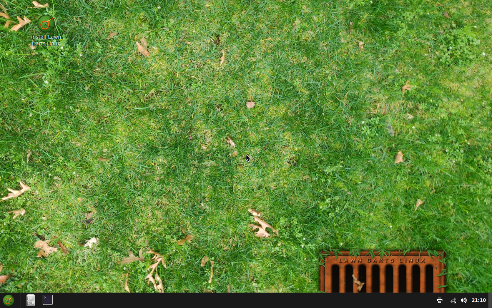

The pipeline's repository has eleven example specs in [examples/](https://github.com/Eric-Ness/linuxlive/tree/main/examples). CI builds and boots every one of them on each change to the pipeline, so each is a spec known to work at v0.9.1. Copy the one closest to what you want and change it.

Their art is in `examples/assets/`, so the paths in them start with `assets/`.

| Spec | Distro | Base | Desktop | What it shows |
| --- | --- | --- | --- | --- |
| `testos-ubuntu.yaml` | TestOS | Ubuntu 26.04 | GNOME | Every kind of extra: a package, a file, all three kinds of script and a GitHub repo |
| `testos-fedora.yaml` | TestOS | Fedora 44 | KDE Plasma | The same extras on Fedora |
| `lawndarts-ubuntu.yaml` | Lawn Darts Linux | Ubuntu 26.04 | Cinnamon | A boot splash of its own, and a pinned dock |
| `lawndarts-fedora.yaml` | Lawn Darts Linux | Fedora 44 | Cinnamon | The same boot splash on Fedora |
| `settings-ubuntu.yaml` | Aula Linux | Ubuntu 26.04 | GNOME | Every setting, in Spanish: computer name, automatic login, hidden entries, the dock, Firefox's home page and a bookmark, and saving to the USB stick |
| `settings-fedora.yaml` | Werkbank Linux | Fedora 44 | KDE Plasma | Settings in German, a Flathub app, a dock with the Flathub app first, and Firefox's home page |
| `settings-cinnamon.yaml` | Varanda Linux | Fedora 44 | Cinnamon | Settings in Brazilian Portuguese, a Flathub app and a dock on Cinnamon |
| `kiosk-ubuntu.yaml` | Borne Linux | Ubuntu 26.04 | GNOME underneath | A Firefox kiosk in French, on its home page with bookmarks |
| `kiosk-fedora.yaml` | Gioco Linux | Fedora 44 | KDE underneath | A GCompris kiosk in Italian, which needs no network |
| `macvm-ubuntu.yaml` | TestOS ARM | Ubuntu 26.04 | GNOME | An ISO for ARM virtual machines only (`arches: [arm64]`) |
| `macvm-fedora.yaml` | TestOS ARM | Fedora 44 | KDE Plasma | The same on Fedora |

CI publishes only the TestOS and Lawn Darts ISOs, which linuxlive.com offers for download. The others exist to prove the settings, kiosk mode and ARM builds in running systems.

## Lawn Darts Linux on Ubuntu

A small distro with a boot splash and a dock of its own. The splash's script and images come from the pipeline's [make_splash_example.py](https://github.com/Eric-Ness/linuxlive/blob/main/scripts/make_splash_example.py); [Boot splash](/spec/boot-splash/) walks through a script like it.

```yaml
# Example spec: Lawn Darts Linux, Ubuntu 26.04 with Cinnamon. CI builds this one and boots it.
# The art comes from scripts/make_lawndarts_assets.py; see assets/lawndarts/CREDITS.md.
schema_version: 1
name: Lawn Darts Linux
version: "0.1"
base: ubuntu
desktop: cinnamon
apps:
  - firefox
  - vlc
branding:
  wallpaper: assets/lawndarts/wallpaper.png
  logo: assets/lawndarts/logo.png
  accent_color: "#e0661f"
  # A boot splash of its own (since v0.9.0): see scripts/make_splash_example.py.
  splash:
    script: assets/lawndarts/splash/lawndarts.script
    images:
      - assets/lawndarts/splash/dart.png
      - assets/lawndarts/splash/bar.png
      - assets/lawndarts/splash/bar-bg.png
settings:
  # Pinned to the panel after the file manager (since v0.9.0).
  dock:
    - vlc
    - firefox
```

There is no `id`, so it is made from the name: `lawn-darts-linux`. The accent colour has no effect on Cinnamon, which has no accent setting, but on Ubuntu it still colours the text-mode boot splash. The panel shows Nemo, then VLC, then Firefox.

The Lawn Darts wallpaper is a public domain photo of a lawn; its sources are listed in `examples/assets/lawndarts/CREDITS.md`.



## Aula Linux

A classroom distro for Spanish schools. It sets every setting on Ubuntu with GNOME and keeps changes on the USB stick.

```yaml
# Example spec: Ubuntu 26.04 with GNOME, set up for a Spanish classroom. CI
# builds and boots it to check every setting: language, keyboard, time zone,
# computer name, automatic login, hidden menu entries and Firefox's policies,
# and that files and settings are saved back to the USB stick.
schema_version: 1
name: Aula Linux
version: "0.1"
base: ubuntu
desktop: gnome
apps:
  - firefox
branding:
  wallpaper: assets/wallpaper.png
  logo: assets/logo.png
  accent_color: "#c2185b"
settings:
  language: es_ES
  keyboard: es
  timezone: Europe/Madrid
  hostname: aula-1
  autologin: true
  hidden_apps:
    - org.gnome.Yelp
    - org.gnome.Ptyxis
  # Pinned to the dock after the file manager (since v0.9.0).
  dock:
    - firefox
# Save files and settings on the USB stick (Ubuntu only, since v0.7.0).
persistence: true
firefox:
  homepage: https://linuxlive.com/
  bookmarks:
    - name: linuxlive Library
      url: https://linuxlive.com/library/
```

Things to notice:

- `hidden_apps` uses desktop file names. On Ubuntu 26.04, Help is `org.gnome.Yelp` and the terminal is `org.gnome.Ptyxis`.
- `persistence: true` only works on Ubuntu. Change `base` to `fedora` and the check refuses it.
- `firefox` needs `firefox` in `apps`.

## The others in brief

**TestOS** (`testos-ubuntu.yaml`, `testos-fedora.yaml`) adds `htop` from the base's archive, copies `assets/extras/motd` to `/etc/motd`, runs a build, a first-boot and a first-login script from `assets/extras/`, and installs a file from a pinned commit of the linuxlive repository:

```yaml
repos:
  - url: https://github.com/Eric-Ness/linuxlive
    commit: 7de84ed49850a29bc2fce32d66d0d83509b99daf
    run: install -Dm644 LICENSE /usr/share/doc/linuxlive-example/LICENSE
```

**Werkbank Linux** (`settings-fedora.yaml`) pins a Flathub app before a catalog app, which shows that `dock` takes ids from both lists:

```yaml
flathub:
  - org.kde.kcalc
settings:
  dock:
    - org.kde.kcalc
    - firefox
```

**Borne Linux** (`kiosk-ubuntu.yaml`) is a Firefox kiosk. `desktop: gnome` is still required: the **Install** boot entry starts it so the installer can run.

```yaml
kiosk:
  app: firefox
```

**TestOS ARM** (`macvm-*.yaml`) sets `id: testos-arm` and `arches: [arm64]`, so it builds only the ARM ISO. Its apps, Firefox and VLC, are both built for ARM on Flathub.

The TestOS art is drawn by `scripts/make_test_assets.py` in the pipeline's repository.
