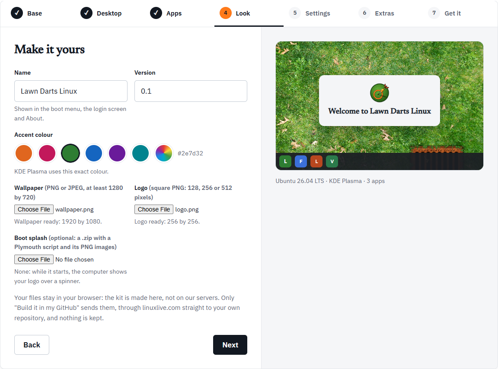

This takes about five minutes in the Workshop, then 15 to 40 minutes of waiting while the build runs. You need a web browser. To build on linuxlive.com or in GitHub you also need a free GitHub account.

## 1. Open the Workshop

Go to [linuxlive.com/workshop/](https://linuxlive.com/workshop/). The seven steps run across the top: Base, Desktop, Apps, Look, Settings, Extras and Get it.

Everything starts filled in. You could press **Next** all the way to the end and get a working distro called My Distro. The [Workshop overview](/workshop/) explains the layout.

## 2. Make your choices

1. **Base**: Ubuntu or Fedora. Pick Ubuntu if you are unsure. See [Base](/workshop/base/).
2. **Desktop**: GNOME, KDE Plasma or Cinnamon. See [Desktop](/workshop/desktop/).
3. **Apps**: a bundle, single apps, or any app from Flathub. See [Apps](/workshop/apps/).
4. **Look**: the name, version, accent colour, wallpaper and logo. Without your own files the kit uses a placeholder. See [Look](/workshop/look/).

**Settings** and **Extras** are optional. Skip them for a first distro.



## 3. Get it

The last step, **Get it**, sums up your choices and offers the ways to build. If a box of problems shows above the buttons, fix each one on its own step and come back.

For a first distro, choose one of these:

- **Build it for me**: linuxlive.com builds it. Sign in with GitHub in the window that opens. You land on your build's page, which shows the progress and then a **Download ISO** button. The download is kept for 30 days. See [The build page](/distros/build-page/).
- **Build it in my GitHub**: linuxlive.com puts your distro in a new public repository of yours, and GitHub builds it, free. The first time, GitHub asks you to install the linuxlive-com app. When the build is done, open the run on GitHub and download the ISO under **Artifacts**. Your distro then shows on [My distros](/distros/my-distros/), where you can change it later.

**Download the kit (.zip)** gives you the files to build yourself instead. [Get it](/workshop/get-it/) explains all three, and [Ways to build](/start/ways-to-build/) compares them.

## 4. Check the download

Each finished build shows a SHA-256 checksum beside the download. Check that your file matches it before you use it. On Windows, in PowerShell:

```powershell
Get-FileHash my-distro.iso -Algorithm SHA256
```

On Linux, `sha256sum my-distro.iso`; on macOS, `shasum -a 256 my-distro.iso`. The long string it prints must match the one on the page, character for character. PowerShell prints it in capital letters, which is fine.

A build in your own GitHub arrives as a zip named `iso-<your distro>`. Unzip it first: the ISO and its checksum file are inside.

## 5. Try it

- **In a virtual machine**: the quickest way, and nothing on your PC changes. See [VirtualBox](/help/virtualbox/).
- **From a USB stick**: write the ISO to a stick of 8 GB or more and start a PC from it. See [USB stick](/help/usb-stick/).

The live system runs without touching the PC's disk. To put it on a disk for good, see [Installing](/help/installing/).

## Next

- Change your distro and save a new version: [My distros](/distros/my-distros/).
- Share it with everyone: [The Library](/distros/library/).
