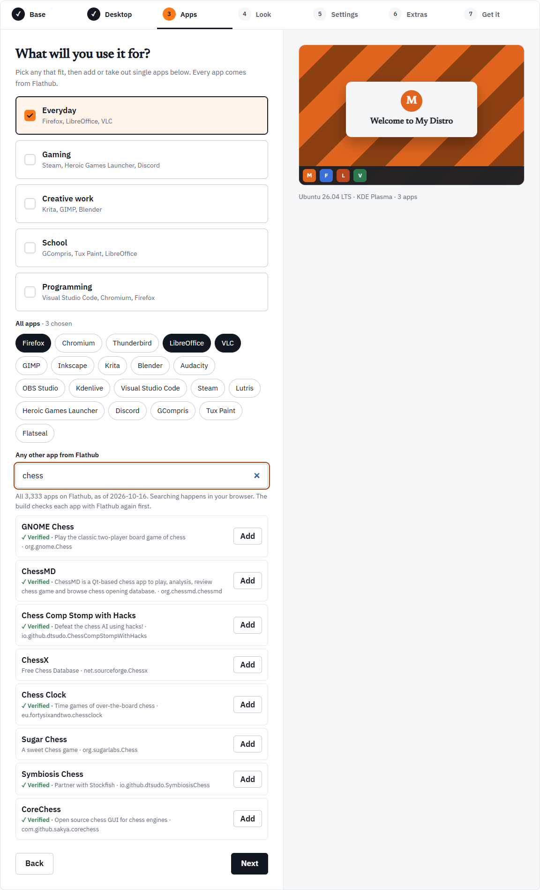

The third step asks "What will you use it for?". Every app comes from Flathub, so the same list works on Ubuntu and Fedora. The apps are installed in the ISO, ready when it starts.

The step has three parts, top to bottom: bundles, all apps, and a search of Flathub.

## Bundles

A bundle is a quick way to add a group of apps.

| Bundle | Apps |
| --- | --- |
| Everyday | Firefox, LibreOffice, VLC |
| Gaming | Steam, Heroic Games Launcher, Discord |
| Creative work | Krita, GIMP, Blender |
| School | GCompris, Tux Paint, LibreOffice |
| Programming | Visual Studio Code, Chromium, Firefox |

Everyday is ticked when you open the Workshop. Tick as many bundles as fit.

Bundles only add and take out apps. They are not saved in your distro, only the apps are:

- Ticking a bundle adds the apps from it you do not have yet.
- Unticking a bundle takes its apps out, except those another ticked bundle also has. With Everyday and Programming both ticked, unticking Programming keeps Firefox, because Everyday has it.
- A bundle shows as ticked only when all its apps are chosen. Take Firefox out by hand and both Everyday and Programming untick, though the rest of their apps stay.

## All apps

Under the bundles, **All apps** shows every app in linuxlive's catalog as a chip. A highlighted chip is chosen; click a chip to add or remove that app. The heading counts them, for example "· 3 chosen".

The catalog's apps, besides those in the bundles, are Thunderbird, Inkscape, Audacity, OBS Studio, Kdenlive, Lutris and Flatseal.

## Any other app from Flathub

The search box, **Any other app from Flathub**, finds any app on Flathub by name, words in its summary, or its Flathub ID. Try "chess", "Spotify" or "a calculator".

How the search works:

- **It searches a snapshot.** The Workshop carries a copy of Flathub's app list, taken on a set date. The help under the box says how many apps it holds and when it was taken, for example "All 3,333 apps on Flathub, as of 2026-10-16". An app added to Flathub after that date will not show up yet.
- **It runs in your browser.** Nothing you type is sent anywhere.
- **Results.** Up to eight, best match first: an exact name, then names in which each word you typed starts a word, then names that contain your words anywhere, then matches in the summary or ID. Ties go to the most installed app.

Each result shows the app's name, its summary and its Flathub ID, with two marks to look for:

- **✓ Verified** is Flathub's own verified mark for the app. linuxlive shows it but does not require it.
- **not for PCs** means Flathub has no build of that app for ordinary PCs (x86_64). Its **Add** button is greyed out.

Press **Add** to choose an app. It appears in a list under the search with a **Remove** button, and the count above the chips adds "and 1 from Flathub below". If the app you add is already in the catalog, Firefox say, the Workshop ticks its chip instead.

You can add up to 50 apps from Flathub.

:::note
The build checks every Flathub app with Flathub again before it starts: the app must still exist, be an app rather than a runtime, and be built for the ISO's kind of computer. An app removed from Flathub after the snapshot fails that check, and the build stops there. See [Build checks](/help/build-checks/).
:::

## Apps and the other steps

Your apps feed three things on the [Settings](/workshop/settings/) step: **Pin to the dock**, **Kiosk mode**, and the Firefox home page and bookmarks (which need Firefox). If you take out an app that one of those uses, the Settings step tells you to add it back.

With **Also build for ARM** ticked on the [Base](/workshop/base/) step, apps made only for PCs become a problem to fix.
