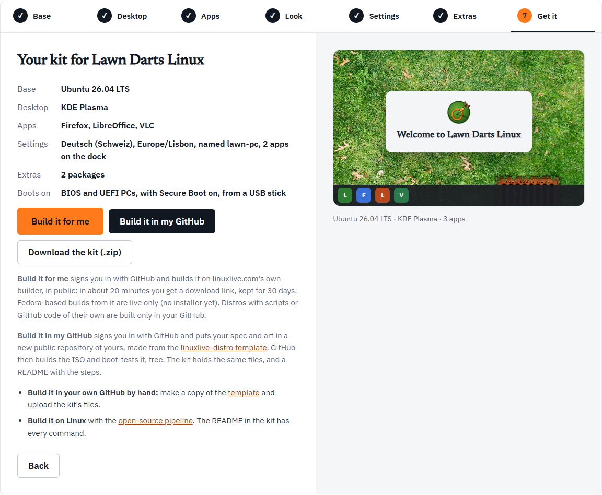

The last step is headed "Your kit for" and your distro's name. It shows a summary, any problems left to fix, and the buttons that build your distro.

## The summary

| Line | What it shows |
| --- | --- |
| Base | Ubuntu 26.04 LTS or Fedora 44 |
| Desktop | GNOME, KDE Plasma or Cinnamon |
| Apps | Every app you chose, Flathub ones included, or "None yet" |
| Settings | What you set on [Settings](/workshop/settings/), or "None" |
| Extras | What you added on [Extras](/workshop/extras/), or "None" |
| Boots on | "BIOS and UEFI PCs, with Secure Boot on, from a USB stick", plus ARM64 virtual machines if you ticked ARM on [Base](/workshop/base/) |

If anything needs fixing, a box under the summary lists it, and the buttons stay greyed out until it is fixed. See [the Workshop overview](/workshop/).

## Three ways to get it

| | Download the kit | Build it in my GitHub | Build it for me |
| --- | --- | --- | --- |
| You need | Nothing | A GitHub account | A GitHub account |
| Who builds | You: on GitHub by hand, or on Linux | GitHub, in a repository of yours | linuxlive.com's builder |
| Your files go | Nowhere | Into your own public repository | To linuxlive.com's public builds |
| Scripts and GitHub code | Yes | Yes | No |
| Fedora installer | Yes, when built on GitHub from the template | Yes | No: live only |
| You keep | The zip | The repository, and every build | A download link for 30 days |

**Build it for me** only shows once linuxlive.com's builder is switched on, and not while you are editing a distro. If you do not see it, use one of the other two.

## Download the kit

**Download the kit (.zip)** makes a zip of your distro in your browser and saves it. Nothing is sent anywhere. The zip is named after your distro's id, for example `my-distro.zip`, and holds a folder of the same name:

| File | What it is |
| --- | --- |
| `README.md` | The steps to build it, below |
| `linuxlive.yaml` | The spec: every choice you made, as text |
| `assets/wallpaper.png` | Your wallpaper (or `.jpg`, if a JPEG could not be converted), or the striped placeholder |
| `assets/logo.png` | Your logo, or the placeholder logo |
| `assets/splash/` | Your boot splash's script and images, if you added one |
| `scripts/` | Your build, first-boot and first-login scripts, if any |
| `files/` | The files you added on Extras, if any |

The spec's first lines are comments saying the Workshop made it and on what date.

### Building from the kit

The kit's README gives two ways:

1. **In your own GitHub, by hand.** Open the [linuxlive-distro template](https://github.com/Eric-Ness/linuxlive-distro), click **Use this template**, then **Create a new repository**, and keep it public. In the new repository choose **Add file**, then **Upload files**, and drop in everything from the kit except its README. They replace the template's example. Commit, and the Actions tab shows the build. When it finishes, download `iso-<your id>` under the run's Artifacts: a zip with the ISO and its checksum. More in [GitHub Actions](/spec/github-actions/).
2. **On your own Linux machine**, with the open-source pipeline. The README lists the commands; [Building locally](/spec/building-locally/) explains them.

The README ends with Markdown for a "Built with linuxlive" badge you can paste into your repository's README.

The kit is also how you make a new version later: see [Open and remix](/workshop/open-and-remix/).

## Build it in my GitHub

**Build it in my GitHub** does the template steps for you. It signs you in with GitHub, makes a new public repository of yours from the [linuxlive-distro template](https://github.com/Eric-Ness/linuxlive-distro), and puts your spec and art in it as one commit. GitHub then builds the ISO and boot-tests it, free.

Your files go through linuxlive.com straight into your repository. linuxlive.com keeps nothing.

The steps show in a box under the buttons. The first time, there are a few more of them.

### 1. Sign in

If you are not signed in, a window opens: "Sign in with GitHub in the window that opened." Sign in there. The window closes itself and the Workshop carries on.

### 2. Install the linuxlive-com app

The first time, GitHub asks you to install the **linuxlive-com** app on your account: "Install the linuxlive-com app on your GitHub account in the window that opened. It only gets the repositories you choose." This lets linuxlive.com write to the repositories you allow, and nothing else.

### 3. Your repository is made and filled

The Workshop says "Putting my-distro in your GitHub…". The repository is named after your distro's id. linuxlive.com makes it from the template, waits a few seconds for GitHub to fill it, and commits your files.

If you already have a repository of that name made from the template, your files go into it as a new commit. A repository of that name made from a different template is refused: "… was made from another template; pick another name."

### When GitHub wants you to do a step

Sometimes GitHub will not let the app make the repository, or the app cannot see it. Then the box asks you to do one step on github.com and press **Continue**:

- **Create the repository yourself.** "GitHub wants you to make the repository yourself. Open the link, keep the name my-distro and press Create repository, then come back here." The link, **Make the repository on GitHub**, opens GitHub's new-repository page with the template, the name and public already filled in.
- **Add the repository to the app.** "The linuxlive-com app cannot reach my-distro yet. Open the app's settings, add that repository, save, then come back." This happens when you installed the app for selected repositories only, and this one is not among them. The link, **Open the app's settings on GitHub**, goes straight there.

After **Continue**, the Workshop tries again. After six rounds it gives up: "That took too many rounds. Download the kit instead, or try again."

### Done

> Done: your spec and art are in you/my-distro. GitHub is building the ISO now; it takes about 30 minutes, and the finished ISO is under the run's Artifacts.

Two links follow: **Watch the build on GitHub** and **See all your distros**, which opens [My distros](/distros/my-distros/). The kit's README puts the time at about 20 minutes for Ubuntu and 40 for Fedora.

### Pop-ups

Sign-in and the app install open in a pop-up window. If your browser blocks it, you see:

> Your browser blocked the GitHub window. Allow pop-ups for linuxlive.com and try again.

Allow pop-ups for linuxlive.com and press the button again. If you close the window before signing in, the Workshop says "You are not signed in yet. Press the button again to retry."

## Build it for me

**Build it for me** builds your distro on linuxlive.com's own builder, so you do not need a repository.

- **Sign in.** It signs you in with GitHub in a pop-up. Here linuxlive.com "only asks who you are".
- **About 20 minutes.** That is the Workshop's estimate. You are taken to your build's page, which shows its progress step by step. See [The build page](/distros/build-page/).
- **In public.** Everything about the build is public, the ISO included.
- **Kept for 30 days.** You get a download link, kept for 30 days. After that the build is deleted ("No such build. Builds are kept for 30 days.").
- **Fedora is live only.** A Fedora-based distro built this way boots and runs live, but has no installer yet. For a Fedora distro that installs, use **Build it in my GitHub**.
- **No code of its own.** A distro with scripts or GitHub code is built only in your GitHub. The button is greyed out for it. Packages, files, settings and a boot splash are fine.

If the builder is full, you see "linuxlive.com is building as many distros as it can right now. Try again in a few minutes."

## Save (when editing)

When you open a distro from [My distros](/distros/my-distros/) with **Edit the spec**, the Workshop is editing that repository. **Get it** then shows **Save** instead of **Build it in my GitHub** and **Build it for me**. The button names the version and repository, for example "Save version 0.2 to you/my-distro".

**Save** puts your changes in the same repository as one commit, and GitHub builds and boot-tests the new version, as it did the last. The commit message lists what changed. **Download the kit (.zip)** still works if you would rather keep a copy.

> Saved: version 0.2 of My Distro is in you/my-distro. GitHub is building and boot-testing it now; it takes about 30 minutes.

Save is off when:

- the spec holds something the Workshop cannot hold. The bar at the top lists what, with a link to edit `linuxlive.yaml` on GitHub instead. See [Open and remix](/workshop/open-and-remix/#what-the-workshop-cannot-hold).
- the repository changed on GitHub after you opened it. Nothing is saved, and you see "… changed on GitHub after you opened it here, so nothing was saved. Open it from My distros again to see the change, then make yours."

Comments in the spec are not kept when you save here.
