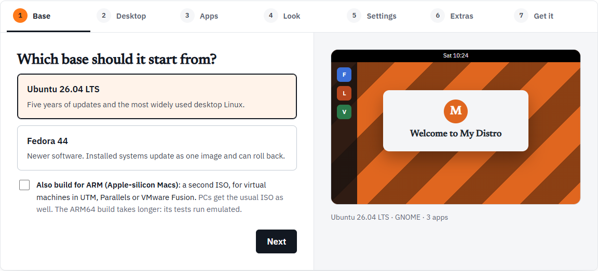

The Workshop at [linuxlive.com/workshop/](https://linuxlive.com/workshop/) is where you make a distro without writing any code. You pick a base, a desktop, apps and your own art. At the end, linuxlive builds an ISO, boot-tests it, and hands it to you. The ISO boots on BIOS and UEFI PCs, with Secure Boot on, from a USB stick.

## The seven steps

The steps run across the top of the Workshop. Click any of them to jump straight to it.

| Step | What you choose | Page |
| --- | --- | --- |
| 1. Base | Ubuntu or Fedora, and whether to build for ARM too | [Base](/workshop/base/) |
| 2. Desktop | GNOME, KDE Plasma or Cinnamon | [Desktop](/workshop/desktop/) |
| 3. Apps | Bundles, single apps, and any app from Flathub | [Apps](/workshop/apps/) |
| 4. Look | Name, version, accent colour, wallpaper, logo, boot splash | [Look](/workshop/look/) |
| 5. Settings | Language, keyboard, time zone, the dock, Firefox, kiosk mode and more (optional) | [Settings](/workshop/settings/) |
| 6. Extras | Packages, scripts, files and code from GitHub (optional) | [Extras](/workshop/extras/) |
| 7. Get it | A summary, then how you want it built | [Get it](/workshop/get-it/) |

The first four steps are the choices every distro needs. Settings and Extras are marked optional. Leave them alone and nothing changes. Extras is for people who already know Linux.

## Moving through the steps

Under each step are **Back** and **Next**. On Extras, the step before the last, **Next** becomes **Review** and takes you to **Get it**. Steps you have passed show a tick in the steps bar.

Everything starts filled in, so you can press **Next** all the way to the end and get a working distro called My Distro: Ubuntu, GNOME, and the Everyday apps (Firefox, LibreOffice and VLC).

## The preview

Beside the steps is a small picture of your desktop. It changes as you go:

- the layout follows the desktop you picked: a top bar and a dock for GNOME, a bottom panel for KDE Plasma and Cinnamon
- the wallpaper is your upload, or stripes in your accent colour until you add one
- your logo, or the first letter of your distro's name, sits in a "Welcome to" window
- the first six of your apps show as coloured tiles

Under the picture a caption sums it up, for example "Ubuntu 26.04 LTS · GNOME · 3 apps". The preview is a sketch to help you choose. It is not a screenshot of the real system.

## Your files stay in your browser

The Workshop runs in your browser. Your wallpaper, logo, boot splash and extras files are checked and zipped on your computer, not on linuxlive.com's servers. They leave your computer only when you ask for a build:

- **Build it in my GitHub** sends them through linuxlive.com straight into your own GitHub repository, and linuxlive.com keeps nothing.
- **Build it for me** sends them to linuxlive.com's builder, which builds in public.

**Download the kit (.zip)** never sends anything anywhere. See [Get it](/workshop/get-it/) for all three.

## Problems show on Get it

The Workshop checks your choices against the same rules the build uses. Some fields tell you right away, under the field: a name it cannot use, a logo of the wrong size, a package name that looks like an ordinary word.

Problems with your choices are also collected on **Get it**, in a box above the buttons. While that box shows anything, **Download the kit (.zip)**, **Build it in my GitHub** and **Build it for me** are greyed out. Fix each problem on its own step, come back, and the buttons work again.

A problem reads like this:

> The home page and bookmarks are Firefox's: add Firefox on the Apps step.

An image or boot splash that fails its check is different. The Workshop does not take it at all: the message stays under that field, and the kit goes on using the placeholder (or no splash) until you choose a file that passes.

## Made one before?

Above the Workshop is **Open its kit (.zip)**. It loads a kit the Workshop gave you, or your distro's repository downloaded from GitHub as a zip, so you can make a new version. A distro in the [Library](/distros/library/) can be remixed the same way. See [Open and remix](/workshop/open-and-remix/).
