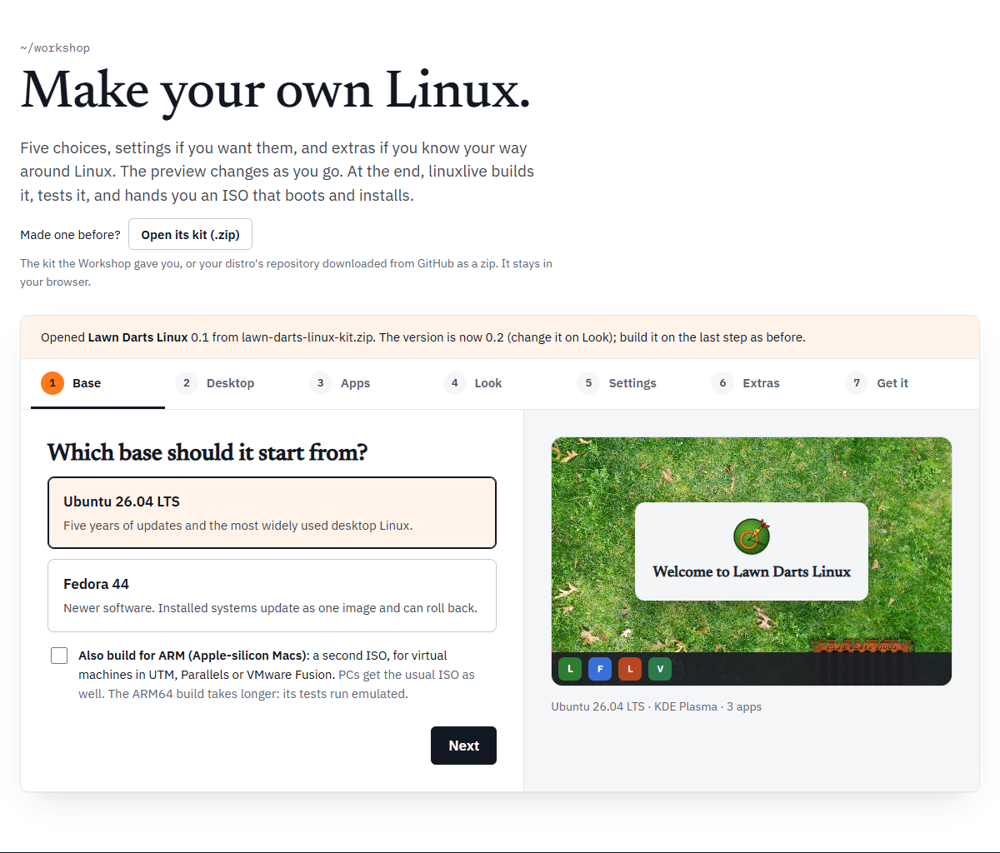

The Workshop does not remember your distro between visits. To change one you made before, you open its kit. To start from someone else's, you remix it from the Library.

## Open its kit (.zip)

Above the Workshop it says "Made one before?" with a button, **Open its kit (.zip)**. It takes either of these:

- **The kit the Workshop gave you**, from **Download the kit (.zip)**.
- **Your distro's repository, downloaded from GitHub as a zip.** On the repository's page on GitHub, open **Code** and choose **Download ZIP**. This works for a distro made with **Build it in my GitHub**, or any repository made from the template.

Like everything else in the Workshop, the zip is read in your browser and stays there.



What the Workshop does with it:

1. It finds the `linuxlive.yaml` nearest the top of the zip. Paths in the spec are read from that file's folder, which is why a GitHub zip, with everything inside one extra folder, works too.
2. It reads every file the spec names: the wallpaper, logo, boot splash, scripts and files.
3. It fills in every step with what it found and goes back to the Base step.
4. It moves the version on by one, so you are making the next version.

A bar above the steps says what happened:

> Opened My Distro 0.1 from my-distro.zip. The version is now 0.2 (change it on Look); build it on the last step as before.

The help under the wallpaper and logo now says they came from the zip, with their sizes. Choose a file to replace either.

### The version moves on one

The last number in the version goes up by one:

| Was | Becomes |
| --- | --- |
| 0.1 | 0.2 |
| 0.9 | 0.10 |
| 2026.10 | 2026.11 |

A version that does not end in a number gets `.1` added. Change it on the [Look](/workshop/look/) step if you want something else.

### When it will not open

| Message | What it means |
| --- | --- |
| That file is not a zip the Workshop can open. | The file is not a zip, or it is damaged. |
| That zip has no linuxlive.yaml. Open a kit the Workshop made, or a distro repository downloaded from GitHub as a zip. | There is no spec in it. |
| Its linuxlive.yaml is not a spec the Workshop can read. | The spec is not valid YAML, or has no `branding` section. |
| Its spec names assets/logo.png, which is not in my-distro.zip. | A file the spec needs is missing from the zip. |
| … is 75 MB; the Workshop opens kits up to 60 MB. | The zip, or what it unpacks to, is over 60 MB. |

## What the Workshop cannot hold

A spec written by hand can say things the Workshop has no field for. When you open one, the Workshop warns you in the bar, under "The Workshop cannot hold everything in it, so the new version differs:", with a list. The things it can report:

- **More than one script of a kind.** "It has 2 build scripts, and the Workshop holds one of each kind." Only the first is kept.
- **File permissions other than 0644 or 0755.** "files/tool has permissions 0700, and the Workshop sets 0644 or 0755."
- **Anything else that would come out different.** The Workshop checks by turning what it loaded back into a spec and comparing the two. Each difference is listed as "Saving it here would change …", naming one of: its name, its id, its version, its base, its desktop, its apps, its Flathub apps, the computers it is built for, its accent colour, its wallpaper, its logo, its boot splash, its packages, its files, its scripts, its GitHub code, its settings, its Firefox home page or bookmarks, its kiosk mode, or whether it saves to the USB stick.

Where files sit in the folder does not count. The Workshop moves them to its own places (`assets/`, `scripts/`, `files/`) and only compares what they hold.

When you open a kit, you can still go on: the new version is built from what the Workshop holds, without what the list names. When you edit a distro from [My distros](/distros/my-distros/), **Save** is turned off instead, and the bar offers a link to edit `linuxlive.yaml` on GitHub. See [Get it](/workshop/get-it/).

### Comments are not kept

If the spec has comments of its own, the bar says "Comments in its linuxlive.yaml are not kept." The Workshop writes a fresh spec with only its own comment lines: the line saying it made the spec and when, the template line, the line above your extras, and a remix credit if there is one.

To keep your comments, edit `linuxlive.yaml` by hand instead. See [Writing linuxlive.yaml](/spec/).

## Remix from the Library

Distros people have shared in the [Library](/distros/library/) have a **Remix in the Workshop** button on their page: "Start your own distro from this one: change anything, then build it." The linuxlive examples, TestOS and Lawn Darts Linux, do not have one.

The button opens the Workshop with that distro loaded, from the exact version its Library page shows:

- The name gets " Remix" on the end, as long as that fits in 40 characters. Otherwise it keeps the original name. Rename it to anything you like.
- The version starts again at 0.1.
- Everything else, art and extras included, is copied in.

The bar names the distro and its author, links back to the Library, and gives the licence of its wallpaper and logo with the author's credits. Check the licence before you share your remix. If the Workshop cannot hold everything in that distro, the bar lists what differs, as above.

Your remix is a new distro of yours. Build it on **Get it** in any of the three ways.

### The credit line

Your remix's spec carries a comment crediting the original. For a made-up distro called Example Linux by octocat, it would read:

```yaml
# Remixed from Example Linux by octocat, https://linuxlive.com/library/example-linux/ (wallpaper and logo: CC-BY-4.0)
```

The Workshop keeps that line. It stays when you open the kit again, and when you save new versions from My distros, even though other comments are dropped.
