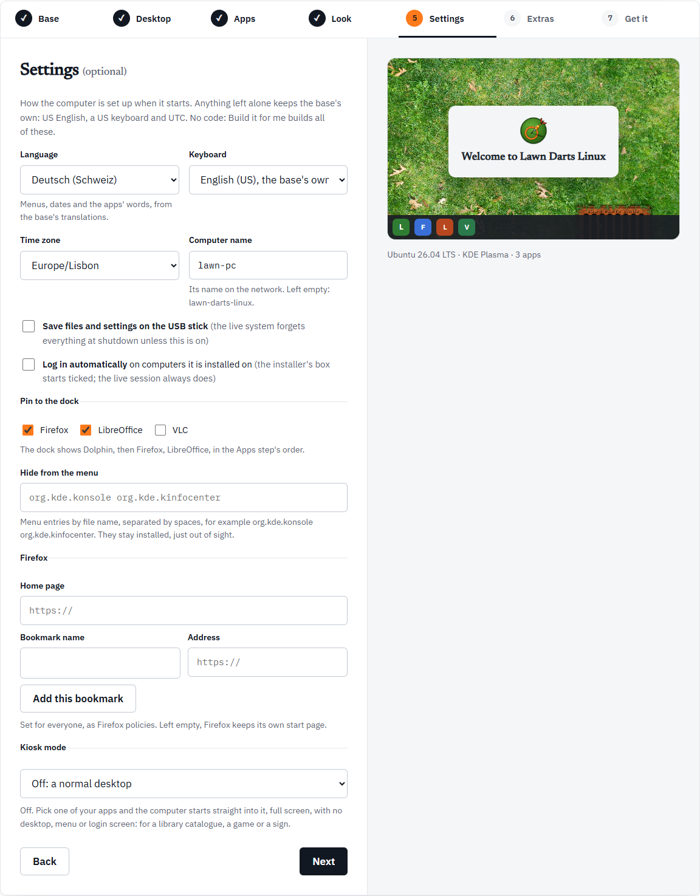

The fifth step, Settings, is optional. It sets up how the computer behaves when it starts. Anything you leave alone keeps the base's own: US English, a US keyboard and UTC.

Settings are data, not code, so a distro that uses any of them can still be made with **Build it for me**.

On **Get it**, the Settings line of the summary lists what you set, for example "Deutsch (Deutschland), German keyboard, Europe/Berlin, named lab-pc". It says "None" when you set nothing.

## Language

The language of menus, dates and the apps' words, from the base's translations. The list has 27 languages, among them English (United Kingdom), Deutsch, Français, Español, Italiano, Português, Polski, 日本語 and 中文（简体）. Left alone, it is English (United States).

For Japanese, Chinese and Korean on Ubuntu, the build adds fonts for those scripts.

## Keyboard

The keyboard layout, from a list of 25, such as English (UK), German, Swiss German, French, Spanish (Latin American), Portuguese (Brazil) and Japanese. Left alone, it is English (US).

The keyboard is separate from the language. A British English system with an Irish keyboard is fine.

## Time zone

Every time zone with a region and city, such as Europe/Berlin or America/Chicago. Left alone, it is UTC.

## Computer name

The computer's name on the network. Use lower-case letters, digits and dashes, up to 63 characters, not starting or ending with a dash. Capitals you type are turned to lower case.

Left empty, it is your distro's id, the short name made from its name: My Distro becomes `my-distro`. The help under the field shows what it will be: "Its name on the network. Left empty: my-distro."

## Save files and settings on the USB stick

Off by default. **Ubuntu-based distros only, for now.**

Normally a live system forgets everything at shutdown. With this on, the boot menu's first entry keeps what you change, the files and apps you add, in the USB stick's free space. The first time, it makes a partition in the space left after the ISO, and finds it again on every boot. A second entry in the boot menu starts clean without touching what was saved. Installing always installs the clean system. This is often called persistence, and in the spec it is [`persistence: true`](/spec/reference/#persistence).

On Fedora the box is greyed out. The reason, as the Workshop puts it: "Fedora's live boot cannot keep changes on a written stick". Fedora keeps changes only on a partition that something has to make on the stick beforehand, and nothing does that for a written ISO.

If you turn it on and then switch to Fedora, **Get it** shows:

> Saving changes on the USB stick works on Ubuntu-based distros only, for now: choose Ubuntu on the Base step, or turn it off.

## Log in automatically

**Log in automatically** on computers it is installed on. With this ticked, the installer's option to log in automatically starts ticked. The live session always logs in automatically, whatever you choose here.

## Pin to the dock

A box for each app you chose on the [Apps](/workshop/apps/) step. Tick the ones you want on the dock.

- Pinned apps go after the desktop's file manager: Files on GNOME, Dolphin on KDE Plasma, Nemo on Cinnamon.
- They appear in the Apps step's order, not the order you tick them. The help spells it out: "The dock shows Files, then Firefox, VLC, in the Apps step's order."
- At most 12 apps.
- With none ticked, each desktop keeps its own dock.

On GNOME it is the dock, on Cinnamon the panel's pinned apps, and on KDE Plasma the task manager's launchers. If you remove a pinned app on the Apps step, the help turns into a problem telling you to add it back. More detail is in [The dock](/spec/dock/).

## Hide from the menu

Menu entries to hide, by their file name without `.desktop`, separated by spaces. The apps stay installed, just out of sight. Some examples to start from, which the field also shows:

| Desktop | Example |
| --- | --- |
| GNOME | `org.gnome.Yelp org.gnome.Tour` |
| KDE Plasma | `org.kde.konsole org.kde.kinfocenter` |
| Cinnamon | `org.gnome.Yelp org.gnome.Terminal` |

Commas and new lines work as separators too, and a `.desktop` ending is taken off for you. The limits:

- each name is letters, digits, `.`, `_` and `-`, starting with a letter or digit
- at most 50 entries
- linuxlive's own entries cannot be hidden ("linuxlive's own menu entries cannot be hidden.")

On Ubuntu the entry stays hidden when its package is updated.

## Firefox

A home page and bookmarks for Firefox, set for everyone as Firefox policies. Both need Firefox in your apps. Without it, the help says "These are Firefox's: add Firefox on the Apps step."

- **Home page.** The page Firefox starts with and its Home button opens. It must start with `https://` or `http://`. Left empty, Firefox keeps its own start page.
- **Bookmarks.** Type a **Bookmark name** and an **Address**, then press **Add this bookmark**. They go on the bookmarks toolbar in the order you add them. An address without `https://` gets it added. Each name can be up to 100 characters, and you can add up to 50 bookmarks. Each has a **Remove** button.

With bookmarks of your own, Firefox's default bookmarks are left out. On a new profile, which every live session starts with, importing them could replace the first of yours.

## Kiosk mode

**Off: a normal desktop** to start with. Pick one of your apps and the computer starts straight into it, full screen, with no desktop, menu or login screen. The Workshop's own suggestions: a library catalogue, a game or a sign.

- The list holds the apps you chose, Flathub apps included.
- The **Install** entry in the boot menu still opens the desktop and the installer, so the distro can still be installed.
- Firefox and Chromium start in their own kiosk mode.
- If you take the kiosk app out on the Apps step, the help says "… is no longer one of your apps: add it back on the Apps step, or turn kiosk mode off."

The kiosk app runs in Cage, a program that shows one app full screen, on the first console.
